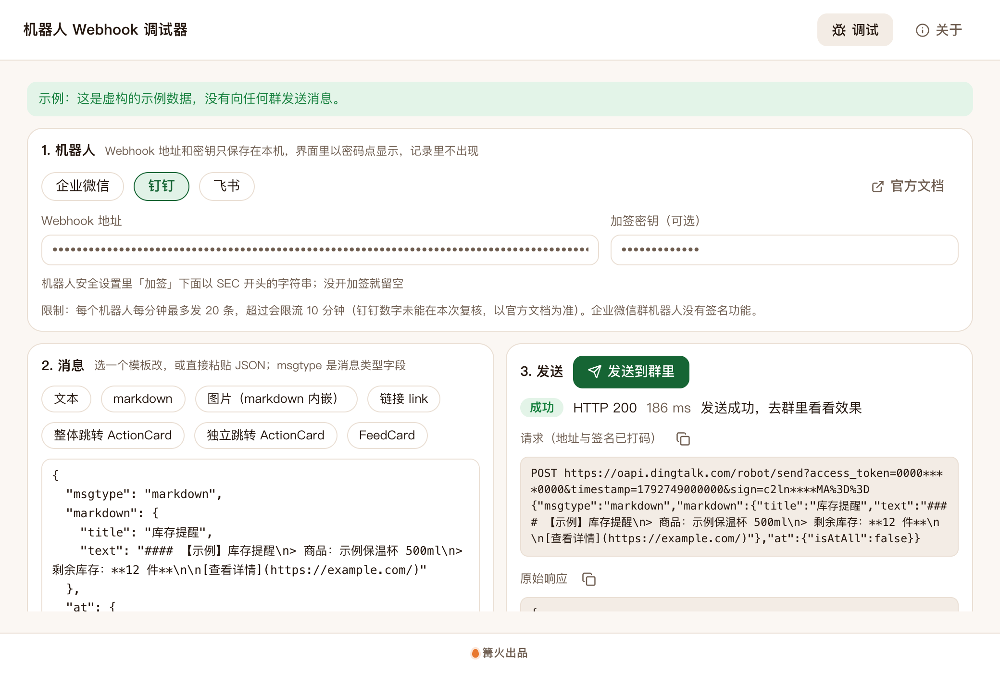

# 机器人 Webhook 调试器

> 篝火出品 · 收录于篝火 App 应用区

钉钉、飞书、企业微信群机器人消息统一调试：写消息、发之前先检查格式、发出后看原始响应和中文解释



## 下载

到 [Releases](https://github.com/campfire-code/bot-webhook-debugger/releases/latest) 下载对应安装包：

| 电脑 | 文件 |
|---|---|
| Windows 10 / 11 | `bot-webhook-debugger_版本号_windows-x64-setup.exe` |
| Mac（Apple 芯片） | `bot-webhook-debugger_版本号_mac-arm64.dmg` |
| Mac（Intel 芯片） | `bot-webhook-debugger_版本号_mac-x64.dmg` |

第一次打开：
- **Windows**：如果弹出「Windows 已保护你的电脑」，点「更多信息」→「仍要运行」。
- **Mac**：如果提示「无法验证开发者」，打开「系统设置 → 隐私与安全性」，在下方点「仍要打开」。

## 怎么用

1. **选平台、填地址**：上方选企业微信 / 钉钉 / 飞书，粘贴机器人的 Webhook 地址。地址格式不对、选错平台会当场提示。钉钉、飞书如果开了「加签」，再填密钥（企业微信群机器人没有签名）。**地址和密钥只保存在本机，界面里以密码点显示，发送记录和报错里不出现。**
2. **写消息**：点一个模板（文本、markdown、图片、图文、卡片等，共 15 个）改内容，或直接粘贴自己的 JSON。JSON 有语法错会指出第几行第几列；按平台文档检查必填字段、字节长度（企微文本 2048、markdown 4096，飞书请求体 20 KB 等）和常见写错的地方（例如把飞书的 `msg_type` 用在钉钉上）。企业微信图片点「选图片」，自动算好 base64 和 md5。
3. **发送**：检查通过后点「发送到群里」，再点一次「确认发送」（会真的发到群里）。右侧显示实际请求（地址和签名已打码）、HTTP 状态、耗时、平台原始响应，以及用中文解释的返回码含义。最近一分钟发得多时会提醒接近限流。
4. **记录**：下方保存最近 50 次发送的时间、平台、类型和结果，不记地址、密钥和消息内容。

### 核实来源与限制

| 事项 | 状态 | 来源 |
|---|---|---|
| 企业微信：text 2048 字节、markdown / markdown_v2 4096 字节、图片编码前不超过 2M 且只支持 JPG / PNG、每个机器人每分钟 20 条 | 已核实（2026-10-23，本次重新读取原文） | 企业微信开发者中心「群机器人配置说明」 |
| 飞书：请求体不超过 20 KB；每个机器人 100 次/分钟、5 次/秒；签名算法（HmacSHA256，密钥为「秒级时间戳\n密钥」，对空串签名，Base64，时间戳与当前相差不超 1 小时）；错误码 9499 / 11232 / 19021 / 19022 / 19024 含义 | 已核实（2026-10-23，本次重新读取原文） | 飞书开放平台「自定义机器人使用指南」 |
| 钉钉：消息类型与字段、加签算法、每分钟 20 条及限流 10 分钟、错误码 310000 细分与其他错误码 | **本次未能复核**（官方文档页正文读取不到）。代码是上一轮按官方文档整理的，签名与 Node 自带 crypto 对照测试一致；以钉钉官方文档为准，用真实机器人发一条确认 | — |
| 企业微信错误码（40058、45009、93000 等）含义 | 本次未复核，以企业微信全局错误码文档为准 | — |
| 飞书 post / 卡片、企微 template_card 的完整字段 | 只检查关键字段，未逐项核实全部字段，以平台文档为准 | — |

已知限制：不上传图片（飞书 `image_key` 需先用飞书「上传图片」接口获取）；不接收回调；企业微信 file / voice 只检查 `media_id`；频率提醒只统计本工具自己发出的条数。目录里写「钉钉、飞书、企微机器人消息统一调试」，实际功能一致（调试发送端，没有接收端 / 回调调试）。

## 验收用例

样例在 `samples/`（全部为虚构的「示例」）。没有真实机器人时，用 1～4 即可验证；5 需要你自己的测试群机器人。

1. 切到「企业微信」，Webhook 地址填 `https://example.com/x`：应立即提示「路径不对」或「地址格式是 https://qyapi.weixin.qq.com/…」，「发送到群里」按钮不可点。
2. 切到「企业微信」，把 `samples/企业微信-文本-示例.json` 的内容粘进消息框：应显示「格式检查通过」。再把 `content` 改成 700 个汉字（2100 字节）：应报「content 有 2100 字节，超过上限 2048 字节」。
3. 切到「飞书」，把 `samples/飞书-请求体格式错误-示例.json` 粘进消息框：应提示 JSON 第 1 行某列语法错误，且发送按钮不可点。
4. 切到「钉钉」，粘入 `samples/钉钉-选错平台-示例.json`：应提示「钉钉用的是 msgtype，不是 msg_type（是不是选错了平台？）」。
5. 切到「企业微信」，点「选图片」选 `samples/图片-示例.png`：消息框自动变成 `msgtype: image`，含 base64 和 32 位 md5，格式检查通过。填入自己群的真实地址，点「发送到群里」→「确认发送」：群里收到图片，右侧显示「成功 / HTTP 200」，原始响应 `errcode: 0`；记录里多一行，不含地址。
6. 用真实钉钉或飞书机器人，故意不含关键词发送：应显示失败并解释为「消息里没有包含机器人安全设置里的任何一个自定义关键词」（飞书 19024 / 钉钉 310000）。
7. 自动化测试：`pnpm test`（46 条），覆盖 JSON 行列定位、三个平台的字段与长度校验、地址检查与打码、钉钉 / 飞书签名（与 node:crypto 独立对照）、MD5 标准测试向量、返回码解释、请求组装与发送（假的网络请求 + 录制的响应），不联网。

## 自己编译

需要 Node.js 22、pnpm、Rust。

```bash
pnpm install
pnpm test          # 单元测试
pnpm tauri dev     # 开发运行
pnpm tauri build   # 打包
```

界面框架在 `src/kit`（所有 campfire-code 工具共用），本工具的逻辑在 `src/tool`。

## 归属

本工具由**篝火**出品，是篝火 App 应用区收录的开源工具之一，由篝火（GitHub 组织 [campfire-code](https://github.com/campfire-code)）维护与更新。全部工具的目录见 [toolkit-hub](https://github.com/campfire-code/toolkit-hub)。

## 许可证

MIT，版权方为篝火（campfire-code）。
